# TP7 – Docker avancé et Docker Compose (multi-stage, non-root, PostgreSQL)

**Étudiante :** Amal Jemli – Master DevOps et Cloud Computing (2026/2027)
**Énoncé :** [TP7 : Docker avancé et Docker Compose](https://docs.teknolabs.net/courses/devops-cloud/partie-3-conteneurs-api/tp7-docker-compose/)

Objectif : produire des images Docker **petites, reproductibles et sûres**, puis décrire une application complète (API + PostgreSQL + Adminer) avec **Docker Compose**, et publier une image **multi-architecture** avec **Buildx**.

---

## Sommaire

1. [Environnement](#1-environnement)
2. [Partie 1 – Couches et cache](#2-partie-1--couches-et-cache)
3. [Partie 2 – Mesurer l'image naïve](#3-partie-2--mesurer-limage-naïve)
4. [Partie 3 – Dockerfile multi-stage](#4-partie-3--dockerfile-multi-stage)
5. [Tableau comparatif](#5-tableau-comparatif)
6. [Partie 4 – Pile Docker Compose](#6-partie-4--pile-docker-compose)
7. [Partie 5 – Buildx et images multi-architecture](#7-partie-5--buildx-et-images-multi-architecture)
8. [Défi 1 – Reverse proxy Nginx et `--scale app=3`](#8-défi-1--reverse-proxy-nginx-et---scale-app3)
9. [Défi 2 – Secret de build BuildKit](#9-défi-2--secret-de-build-buildkit)
10. [Fichiers du rendu](#10-fichiers-du-rendu)
11. [Difficultés rencontrées](#11-difficultés-rencontrées)

---

## 1. Environnement

| Élément | Valeur |
|---|---|
| Hôte | PC Windows, VirtualBox 7.2 |
| VM | `ubuntu-server-26` – Ubuntu Server 26.04.1 LTS, 4 Go RAM, 2 vCPU, disque 50 Go (LVM) |
| Réseau | NAT (SSH via `127.0.0.1:2222`) + host-only `192.168.56.40` |
| Docker Engine | 29.8.2 |
| Docker Compose | v5.6.0 |
| Docker Buildx | v0.37.1 |
| Node.js / npm | v24.22.1 / 11.19.1 |
| Application | `app-starter` : API Express/TypeScript qui compte les visites dans PostgreSQL (`GET /`, `GET /health`) |

---

## 2. Partie 1 – Couches et cache

| Notion | Explication |
|---|---|
| **Couche** | Chaque instruction `RUN`, `COPY`, `ADD` crée une couche en lecture seule, empilée sur la précédente. |
| **Cache** | Si une instruction et ses fichiers d'entrée n'ont pas changé, Docker réutilise la couche existante. |
| **Invalidation** | Dès qu'une couche change, **toutes les suivantes** sont reconstruites. |
| **Contexte** | Dossier envoyé au démon au début du build ; sans `.dockerignore`, il inclut `node_modules/`, `.git/`, `.env`… |

### Génération du fichier de verrouillage

```bash
npm install && ls -l package-lock.json
```

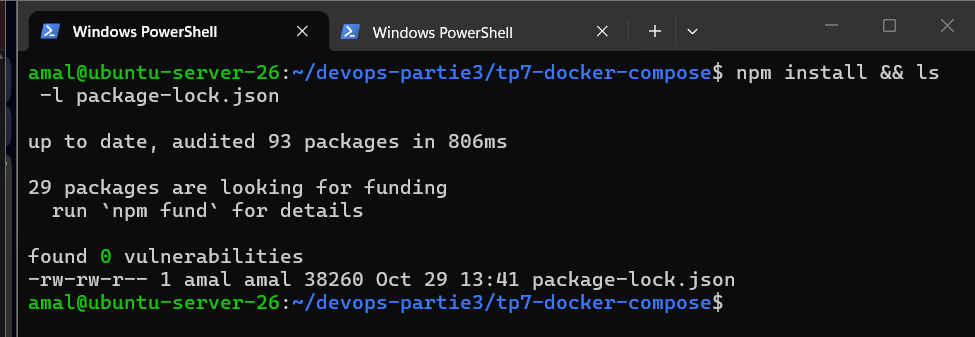

### Build de l'image naïve (à froid)

```bash
time docker build -f Dockerfile.naive -t visits-app:naive .
```

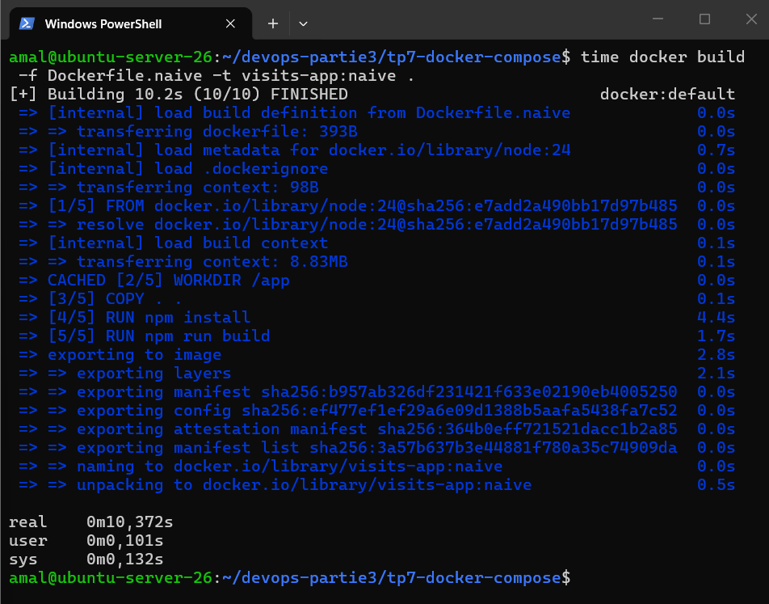

Temps : **10,4 s** (l'image de base `node:24` était déjà présente sur la VM, aucun téléchargement).

### Rebuild après modification du code

```bash
echo "// modification pour tester le cache" >> src/server.ts
time docker build -f Dockerfile.naive -t visits-app:naive .
```

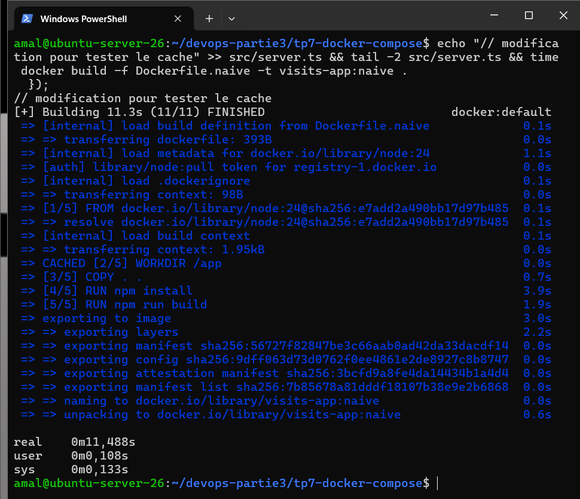

Temps : **11,5 s**. Les étapes `COPY . .` **et** `RUN npm install` sont réexécutées.

> **Pourquoi `npm install` est-il réexécuté ?**
> Le Dockerfile naïf fait `COPY . .` **avant** `RUN npm install`. Le code source faisant partie de cette copie, toute modification d'un fichier change la couche `COPY`, ce qui invalide le cache de **toutes les couches suivantes**. `npm install` est donc relancé alors que les dépendances n'ont pas changé.

### Couches et taille

```bash
docker history visits-app:naive && docker image ls visits-app
```

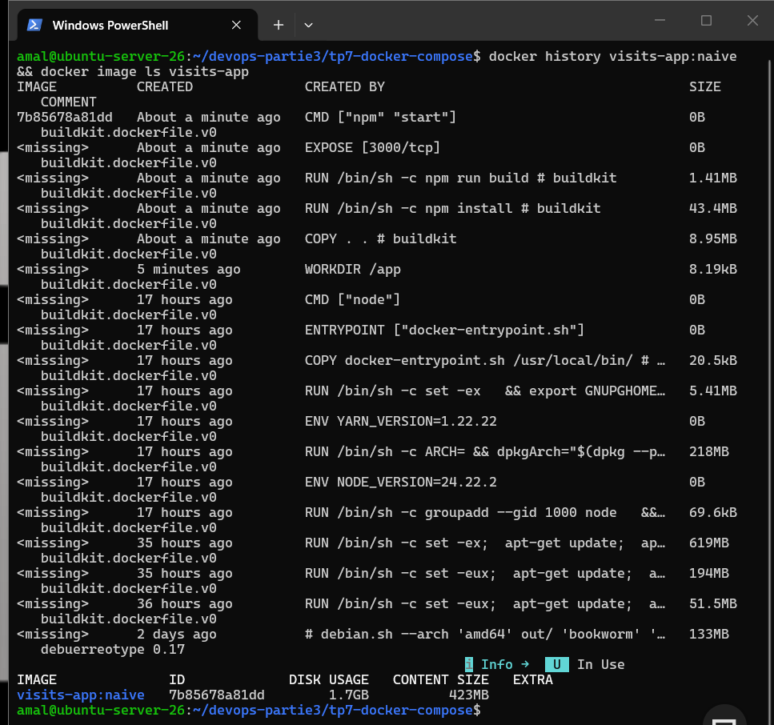

L'image de base `node:24` (Debian bookworm complet) pèse à elle seule près de 1,2 Go, et la couche `npm install` (43,4 Mo) embarque les devDependencies (TypeScript, `@types/*`) inutiles à l'exécution.

---

## 3. Partie 2 – Mesurer l'image naïve

### Vulnérabilités (Trivy en conteneur)

```bash
docker run --rm -v /var/run/docker.sock:/var/run/docker.sock \
  aquasec/trivy:latest image --severity HIGH,CRITICAL --quiet visits-app:naive
```

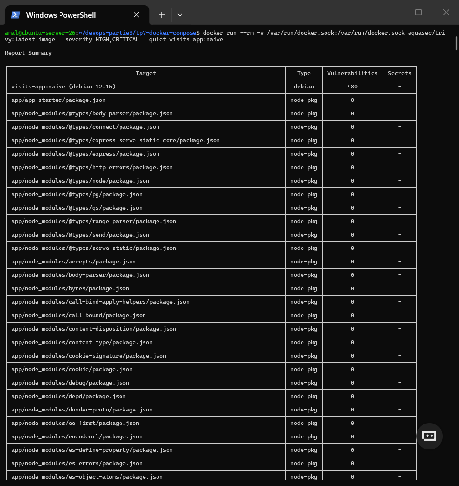

**480 vulnérabilités HIGH/CRITICAL**, toutes dans les paquets Debian 12 de l'image de base (0 dans les dépendances npm).

> Remarque : Trivy a aussi listé `app/app-starter/package.json` : un dossier en double laissé par le `unzip` avait été copié dans l'image par le `COPY . .` du Dockerfile naïf. Il a été supprimé ensuite – illustration concrète du risque d'un contexte de build non filtré.

### Utilisateur du conteneur

```bash
docker run --rm visits-app:naive id
```

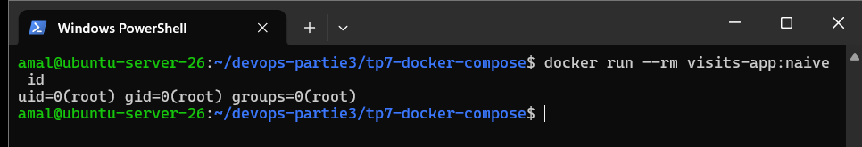

Le conteneur tourne en **root** (`uid=0`). Un processus root dans un conteneur est root sur le noyau de l'hôte si une faille permet de s'échapper du conteneur.

---

## 4. Partie 3 – Dockerfile multi-stage

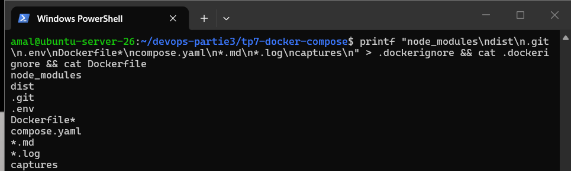

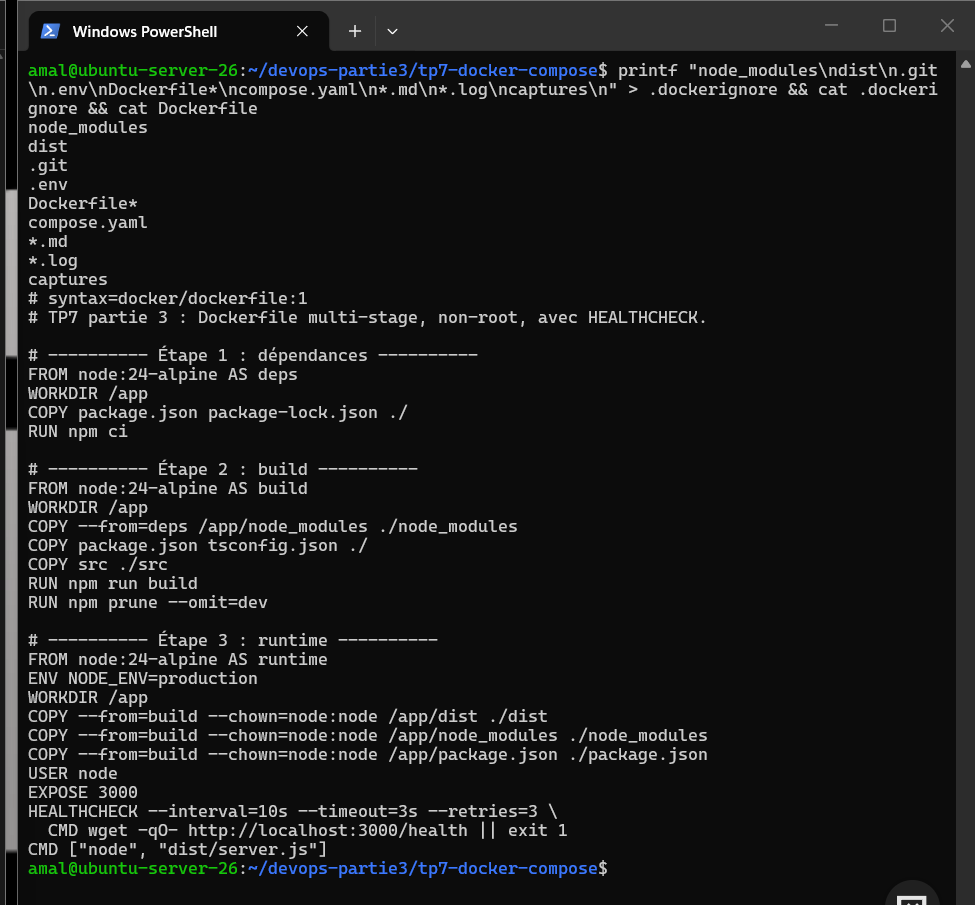

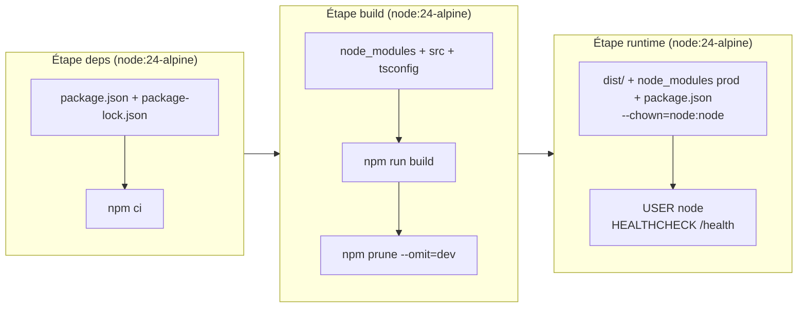

| Étape | Rôle |
|---|---|
| `deps` | Copie **uniquement** `package.json` et `package-lock.json`, puis `npm ci`. Cette couche ne change que si les dépendances changent → elle reste **en cache** quand on modifie le code. |
| `build` | Récupère `node_modules`, copie les sources, compile le TypeScript (`tsc`), puis `npm prune --omit=dev` retire TypeScript et les `@types`. |
| `runtime` | Image Alpine légère qui ne reçoit que `dist/`, les `node_modules` de production et `package.json`, avec `--chown=node:node`, puis `USER node`, `EXPOSE 3000` et un `HEALTHCHECK` (`--interval=10s --timeout=3s --retries=3`) sur `/health`. |

### Build à froid

```bash
time docker build -t visits-app:multistage .
```

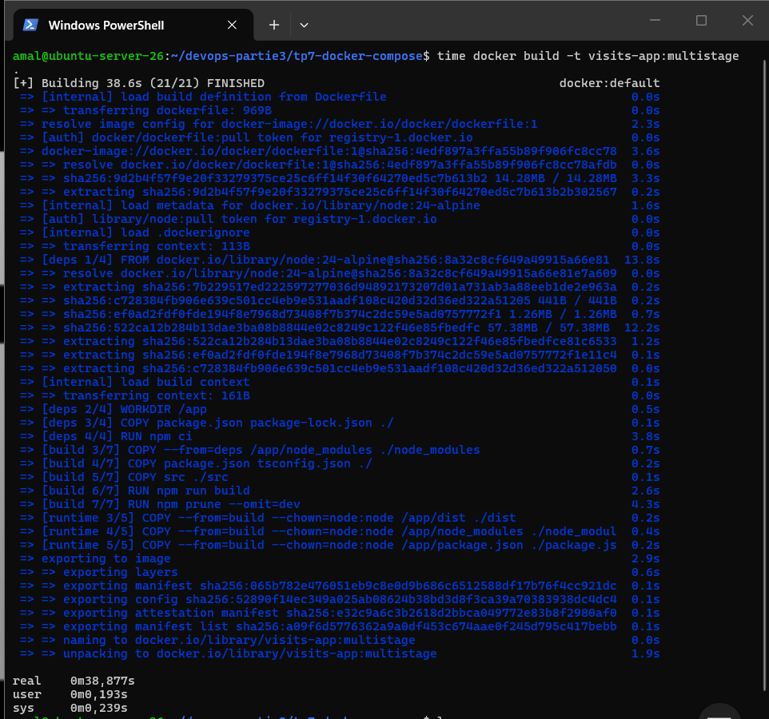

Temps : **38,9 s**, dont environ 20 s de téléchargement (`node:24-alpine` 13,8 s et frontend `docker/dockerfile:1` ~6 s), absents du build naïf dont l'image de base était déjà présente.

### Comparaison des tailles et utilisateur

```bash
docker image ls visits-app
docker run --rm visits-app:multistage id
```

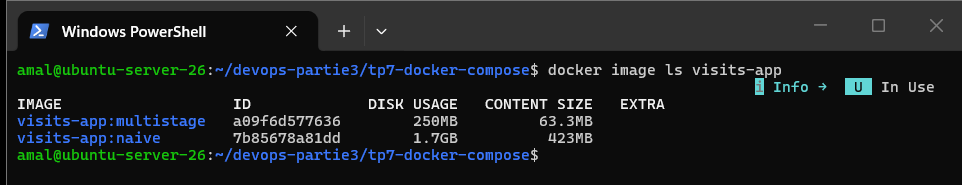

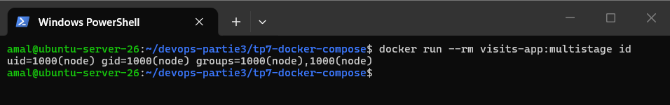

L'image passe de **1,7 Go à 250 Mo (−85 %)** et tourne sous l'utilisateur **`node` (uid=1000)**.

### Rebuild après modification du code

```bash
echo "// modification 2 pour tester le cache" >> src/server.ts
time docker build -t visits-app:multistage .
```

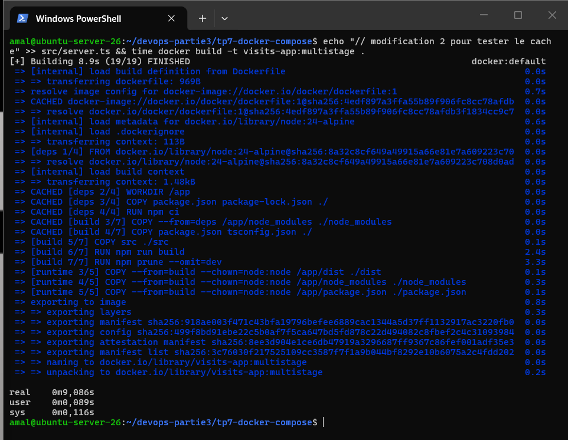

Temps : **9,1 s**. `[deps 4/4] RUN npm ci` est **`CACHED`** : seules les étapes qui dépendent de `src/` sont relancées.

> Piste d'amélioration : `npm prune` (3,3 s) est encore relancé car il se trouve après `COPY src` dans l'étape `build`. Une étape séparée `npm ci --omit=dev` (dépendant uniquement des fichiers `package*.json`) le mettrait lui aussi en cache.

### Vulnérabilités

```bash
docker run --rm -v /var/run/docker.sock:/var/run/docker.sock \
  aquasec/trivy:latest image --severity HIGH,CRITICAL --quiet visits-app:multistage
```

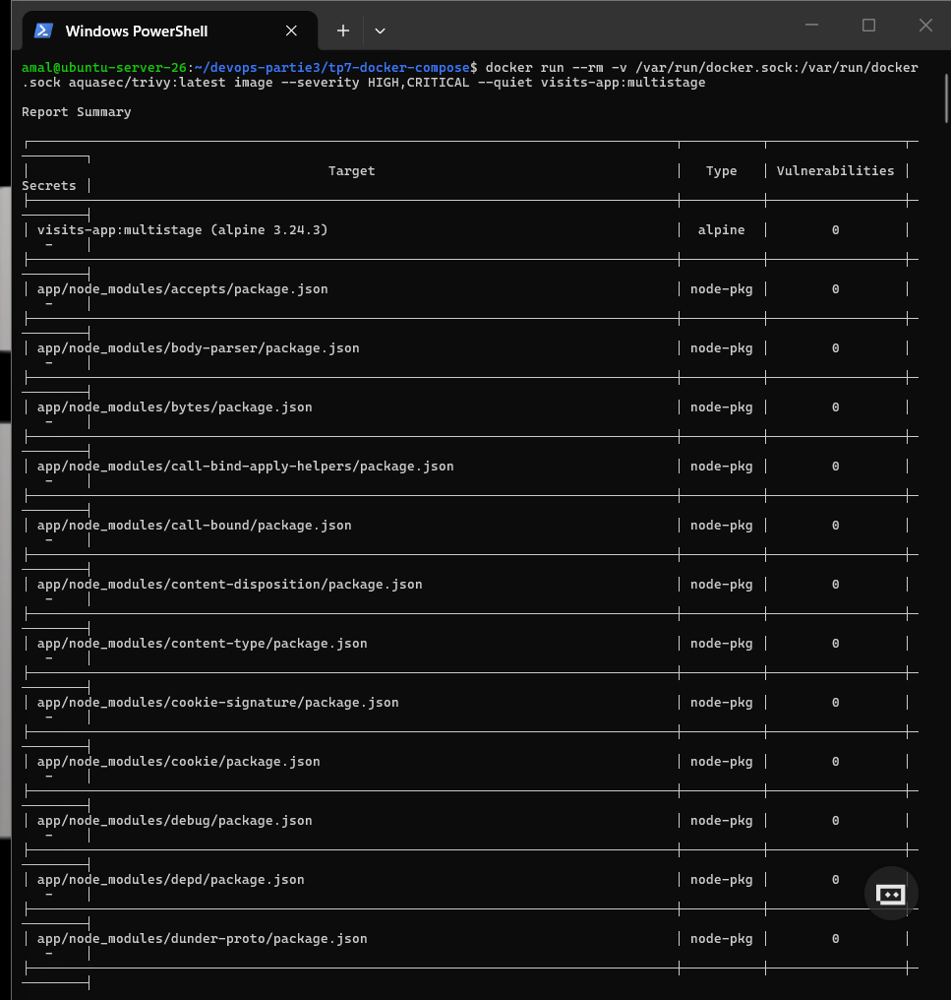

**0 vulnérabilité HIGH/CRITICAL** (Alpine 3.24.3).

---

## 5. Tableau comparatif

| Indicateur | `naive` | `multistage` |
|---|---|---|
| Taille de l'image | 1,7 Go (423 Mo compressés) | **250 Mo (63,3 Mo compressés)** – −85 % |
| Temps de build (à froid) | 10,4 s *(base `node:24` déjà présente)* | 38,9 s *(dont ~20 s de téléchargement de la base Alpine et du frontend)* |
| Temps de build (code modifié) | 11,5 s (`npm install` réexécuté) | **9,1 s** (`npm ci` en cache) |
| Vulnérabilités HIGH/CRITICAL | 480 | **0** |
| Utilisateur | root (uid=0) | **node (uid=1000)** |

**Conclusion :** le build multi-stage produit une image près de 7 fois plus petite, sans vulnérabilité connue grave, qui ne s'exécute pas en root et dont le cache des dépendances est réellement exploité.

---

## 6. Partie 4 – Pile Docker Compose

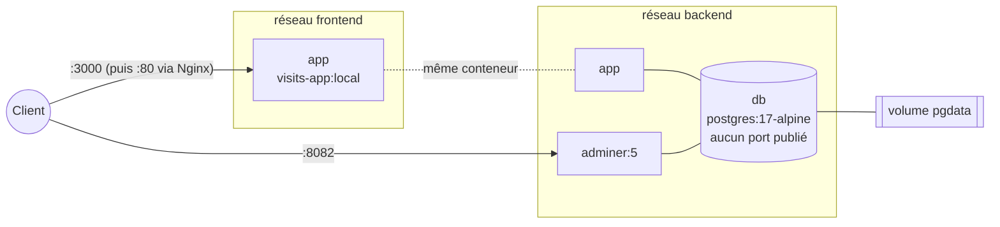

### Fichier `.env`

```bash
cp .env.example .env     # puis choix du mot de passe
git check-ignore -v .env
```

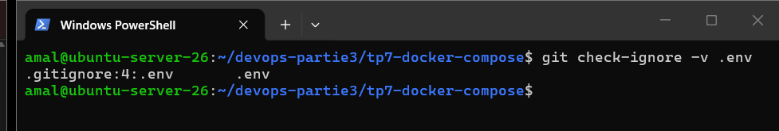

Seul `.env.example` (sans vraie valeur) est versionné ; `.env` est ignoré par `.gitignore`.

### Validation et démarrage

```bash
docker compose config
docker compose up -d --build
```

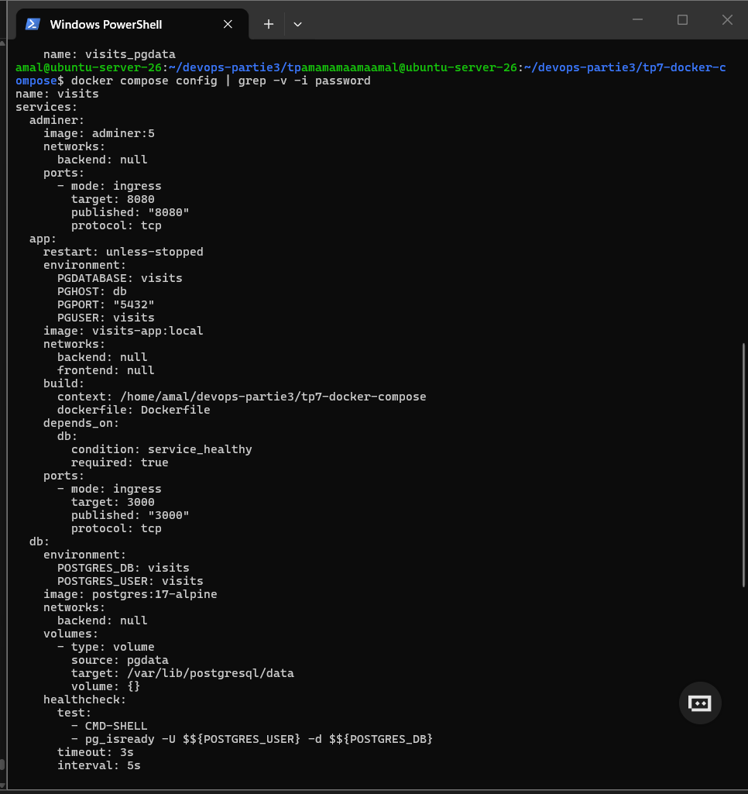

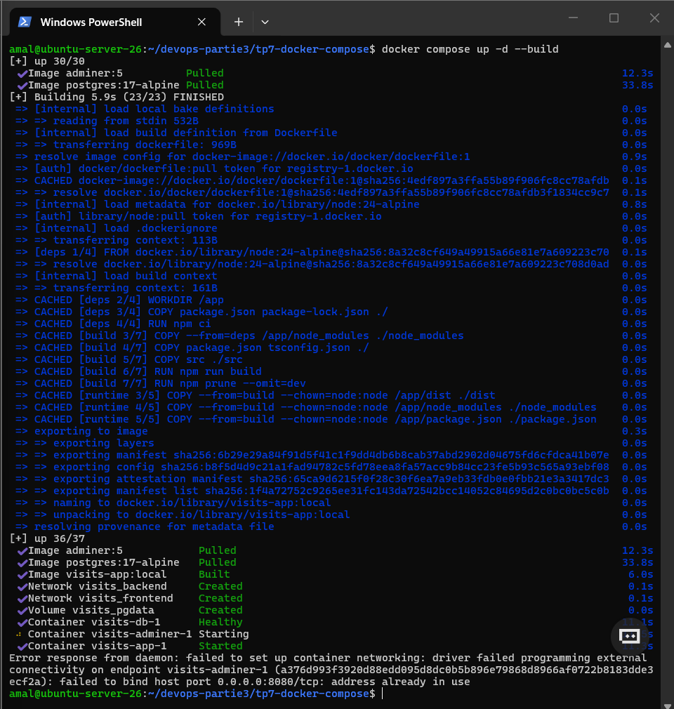

`docker compose config` affiche le fichier résolu (variables du `.env` remplacées). Le `$${POSTGRES_USER}` du healthcheck est volontairement conservé : c'est le shell du conteneur `db` qui le remplace.

> **Conflit de port :** au premier `up`, Adminer n'a pas pu démarrer (`address already in use` sur 8080). `sudo ss -ltnp | grep ':8080'` a montré que le port était déjà pris par **Jenkins** (`java`), installé lors d'un TP précédent. Adminer a donc été publié sur **8082** (`"8082:8080"`).

### État de la pile

```bash
docker compose ps
```

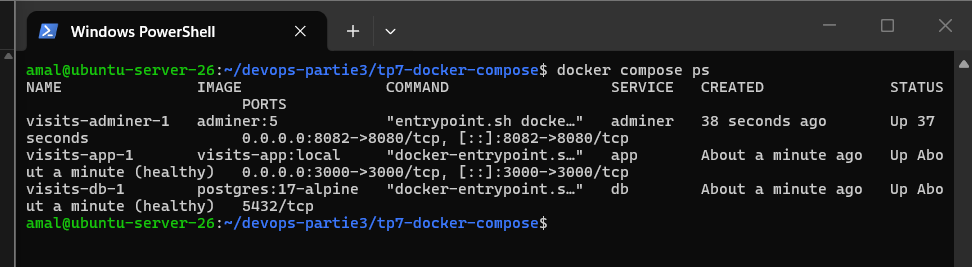

- `db` est **healthy** (healthcheck `pg_isready`) ;
- `app` n'a démarré qu'après `db` healthy (`depends_on: condition: service_healthy`) et devient lui-même **healthy** grâce au `HEALTHCHECK` du Dockerfile ;
- `db` affiche `5432/tcp` **sans** `0.0.0.0:` → port non publié sur l'hôte.

### Test de l'application

```bash
curl http://localhost:3000/ ; curl http://localhost:3000/ ; curl http://localhost:3000/ ; curl http://localhost:3000/health
```

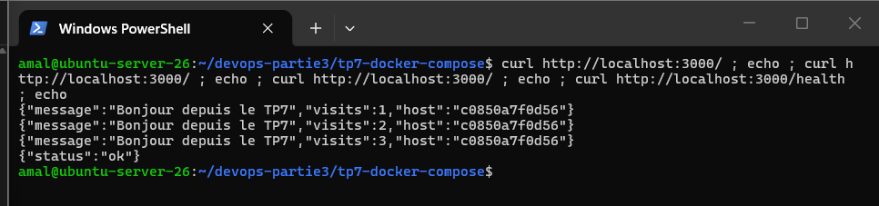

### Adminer

`http://192.168.56.40:8082` – Système **PostgreSQL**, serveur `db`, base `visits` :

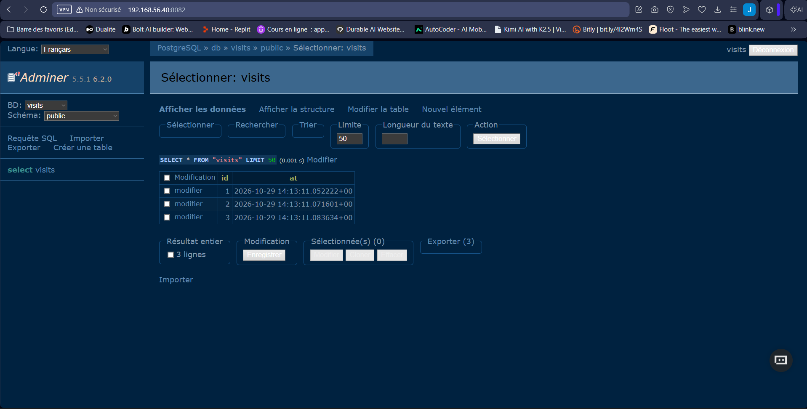

### Persistance

```bash
docker compose down && docker compose up -d && sleep 8 && curl http://localhost:3000/
```

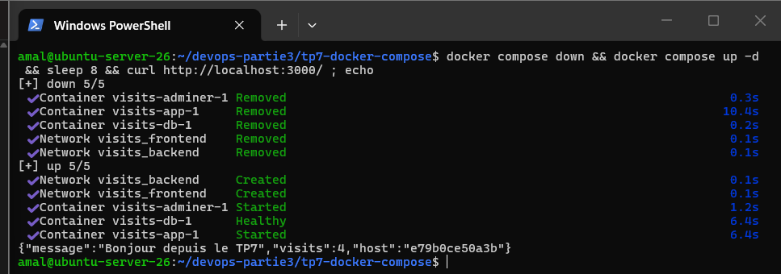

Le compteur reprend à **4** après 3 : `down` supprime les conteneurs et les réseaux mais **pas** le volume nommé `visits_pgdata`. Le champ `host` a changé (nouveau conteneur) mais les données, stockées dans le volume, sont conservées.

> **Que fait `docker compose down -v` ?** L'option `-v` supprime aussi les **volumes nommés** déclarés dans le fichier (ici `visits_pgdata`) : toutes les données PostgreSQL sont perdues et le compteur repartirait à 1.

> Observation : l'arrêt de `app` prend ~10 s contre 0,2 s pour les autres services. Node, lancé en PID 1, ne gère pas `SIGTERM` ; Docker attend le délai de grâce de 10 s puis envoie `SIGKILL`. `init: true` dans le service corrigerait ce comportement.

### Isolation réseau

```bash
psql -h localhost -U visits -d visits -c "select 1"
docker compose exec app nslookup db
curl -s http://localhost:3000/
```

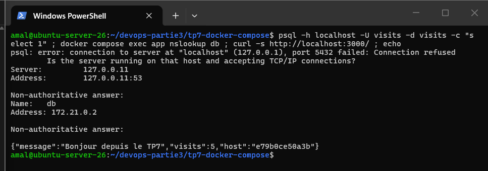

| Test | Résultat | Explication |
|---|---|---|
| `psql -h localhost` depuis la VM | ❌ Connection refused | `db` ne publie aucun port |
| `nslookup db` depuis `app` | ✅ `db` → 172.21.0.2 | DNS interne de Docker (`127.0.0.11`) sur le réseau `backend` |
| `curl localhost:3000` | ✅ `"visits":5` | l'application joint la base par le réseau privé |

### Mise à l'échelle

```bash
docker compose up -d --scale app=2
```

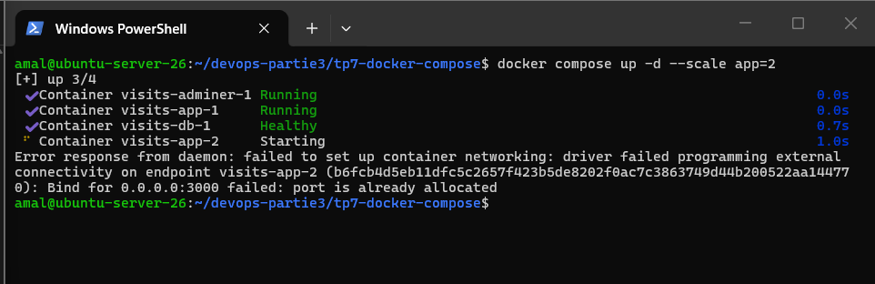

> **Problème :** avec `ports: "3000:3000"`, chaque réplique tente de publier le **même port 3000 de l'hôte** ; un port ne peut être ouvert que par un seul processus → `Bind for 0.0.0.0:3000 failed: port is already allocated`.
> **Solution :** ne plus publier de port sur `app` et placer devant un **reverse proxy** (Nginx), seul à publier un port ; il joint `app:3000` via le DNS interne de Docker, qui renvoie l'adresse de toutes les répliques (voir le défi 1).

---

## 7. Partie 5 – Buildx et images multi-architecture

| Terme | Explication |
|---|---|
| **BuildKit** | Moteur de build par défaut de Docker : étapes parallèles, cache avancé, secrets de build. |
| **Buildx** | Interface CLI de BuildKit : *builders*, plateformes multiples, export du cache. |
| **Manifest list** | Index qui associe une même référence d'image à plusieurs architectures. |

### Émulation arm64 et builder

```bash
docker run --privileged --rm tonistiigi/binfmt --install arm64
docker buildx create --name multiarch --use
docker buildx inspect --bootstrap
```

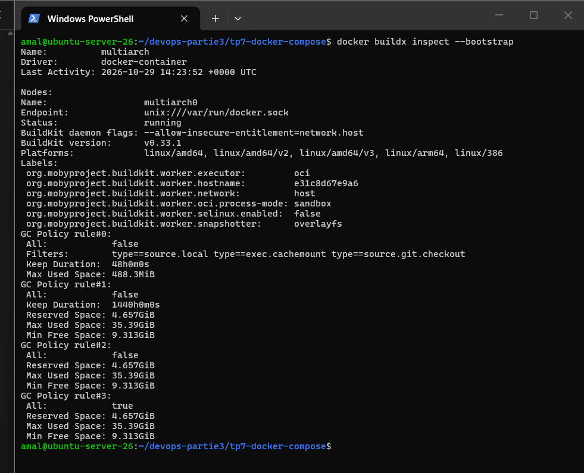

`binfmt` installe l'émulateur `qemu-aarch64`, et le builder `multiarch` (driver `docker-container`) prend en charge `linux/amd64` et `linux/arm64`.

### Build et publication sur Docker Hub

```bash
docker login -u amal878
docker buildx build --platform linux/amd64,linux/arm64 \
  -t amal878/visits-app:1.0.0 --push .
```

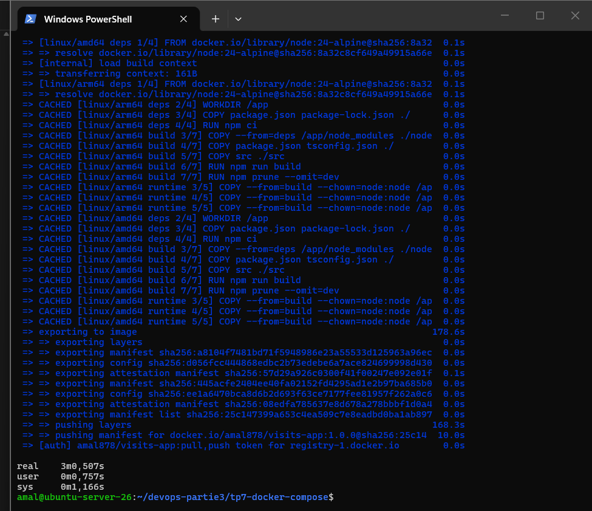

Durée : 3 min 00 s, dont 168 s pour l'envoi des couches des deux architectures vers Docker Hub.

### Vérification du manifest

```bash
docker buildx imagetools inspect amal878/visits-app:1.0.0
docker logout
```

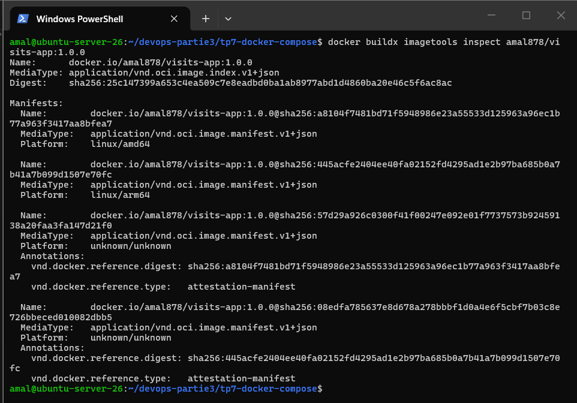

L'image `amal878/visits-app:1.0.0` est un **index OCI** contenant une image `linux/amd64` et une image `linux/arm64` : Docker télécharge automatiquement celle qui correspond à la machine. Les deux entrées `unknown/unknown` sont des **attestations de provenance** ajoutées par BuildKit (une par architecture), pas des images exécutables. L'identifiant Docker Hub a été supprimé de la VM avec `docker logout`.

---

## 8. Défi 1 – Reverse proxy Nginx et `--scale app=3`

`app` ne publie plus de port ; un service `nginx` (réseau `frontend`) est le **seul point d'entrée**, sur le port 80.

```bash
docker compose up -d --scale app=3
for i in 1 2 3 4 5 6; do curl -s http://localhost/; echo; done
```

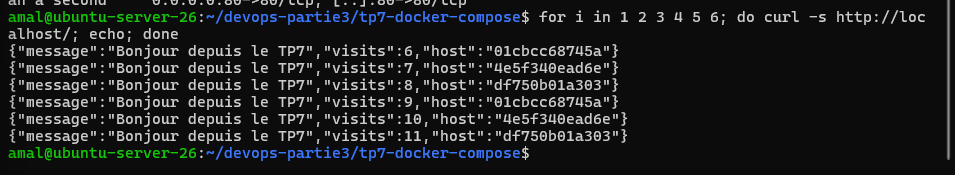

- trois répliques `visits-app-1/2/3` healthy, exposant uniquement `3000/tcp` en interne ;
- le champ `host` alterne en **round-robin** : `01cbcc68745a` → `4e5f340ead6e` → `df750b01a303` → retour au premier ;
- le compteur reste cohérent (6 → 11) car l'état est stocké dans PostgreSQL et non dans l'application : c'est ce qui rend l'application **scalable horizontalement**.

---

## 9. Défi 2 – Secret de build BuildKit

L'étape `deps` monte un fichier `.npmrc` **uniquement pendant** `npm ci` :

```dockerfile
RUN --mount=type=secret,id=npmrc,target=/root/.npmrc npm ci
```

```bash
echo "//registry.npmjs.org/:_authToken=FAUX-TOKEN-TP7" > /tmp/npmrc
docker build --secret id=npmrc,src=/tmp/npmrc -t visits-app:secret .
docker history --no-trunc visits-app:secret | grep -c FAUX-TOKEN
docker save visits-app:secret | grep -a -c FAUX-TOKEN
rm /tmp/npmrc
```

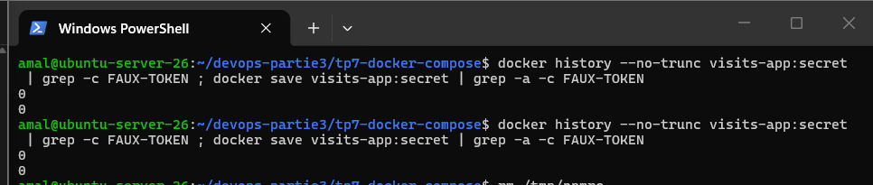

Les deux commandes renvoient **0** : le token n'apparaît ni dans l'historique, ni dans aucune couche de l'image exportée. Avec un `COPY .npmrc` ou un `ARG`, il serait resté lisible dans l'image.

---

## 10. Fichiers du rendu

```
tp7-docker-compose/
├── README.md
├── Dockerfile           # multi-stage, non-root, HEALTHCHECK, secret de build
├── Dockerfile.naive     # point de comparaison (fourni)
├── .dockerignore
├── compose.yaml         # app (x3) + db + adminer + nginx
├── nginx.conf           # reverse proxy du défi 1
├── .env.example         # variables attendues, sans vraie valeur (.env non versionné)
├── package.json / package-lock.json / tsconfig.json
├── src/server.ts
└── captures/
```

### `.dockerignore`

```
node_modules
dist
.git
.env
Dockerfile*
compose.yaml
*.md
*.log
captures
```

### `Dockerfile`

```dockerfile
# syntax=docker/dockerfile:1
# TP7 partie 3 : Dockerfile multi-stage, non-root, avec HEALTHCHECK.

# ---------- Étape 1 : dépendances ----------
FROM node:24-alpine AS deps
WORKDIR /app
COPY package.json package-lock.json ./
RUN --mount=type=secret,id=npmrc,target=/root/.npmrc npm ci

# ---------- Étape 2 : build ----------
FROM node:24-alpine AS build
WORKDIR /app
COPY --from=deps /app/node_modules ./node_modules
COPY package.json tsconfig.json ./
COPY src ./src
RUN npm run build
RUN npm prune --omit=dev

# ---------- Étape 3 : runtime ----------
FROM node:24-alpine AS runtime
ENV NODE_ENV=production
WORKDIR /app
COPY --from=build --chown=node:node /app/dist ./dist
COPY --from=build --chown=node:node /app/node_modules ./node_modules
COPY --from=build --chown=node:node /app/package.json ./package.json
USER node
EXPOSE 3000
HEALTHCHECK --interval=10s --timeout=3s --retries=3 \
  CMD wget -qO- http://localhost:3000/health || exit 1
CMD ["node", "dist/server.js"]
```

### `compose.yaml` (version finale, avec le défi 1)

```yaml
name: visits

services:
  app:
    build: .
    image: visits-app:local
    environment:
      PGHOST: db
      PGPORT: 5432
      PGUSER: ${POSTGRES_USER}
      PGPASSWORD: ${POSTGRES_PASSWORD}
      PGDATABASE: ${POSTGRES_DB}
    depends_on:
      db:
        condition: service_healthy
    networks:
      - frontend
      - backend
    restart: unless-stopped

  db:
    image: postgres:17-alpine
    environment:
      POSTGRES_USER: ${POSTGRES_USER}
      POSTGRES_PASSWORD: ${POSTGRES_PASSWORD}
      POSTGRES_DB: ${POSTGRES_DB}
    volumes:
      - pgdata:/var/lib/postgresql/data
    healthcheck:
      test: ["CMD-SHELL", "pg_isready -U $${POSTGRES_USER} -d $${POSTGRES_DB}"]
      interval: 5s
      timeout: 3s
      retries: 5
    networks:
      - backend
    # aucun port publié : la base n'est joignable que depuis le réseau backend

  adminer:
    image: adminer:5
    ports:
      - "8082:8080"   # 8080 déjà occupé par Jenkins sur la VM
    networks:
      - backend

  nginx:
    image: nginx:1.29-alpine
    ports:
      - "80:80"
    volumes:
      - ./nginx.conf:/etc/nginx/nginx.conf:ro
    depends_on:
      app:
        condition: service_healthy
    networks:
      - frontend
    restart: unless-stopped

volumes:
  pgdata:

networks:
  frontend:
  backend:
```

> Pour la partie 4 (avant le défi), `app` publiait directement `ports: - "3000:3000"` et le service `nginx` n'existait pas.

### `nginx.conf`

```nginx
events {}

http {
  # "app" est résolu par le DNS interne de Docker vers toutes les répliques
  upstream visits_app {
    server app:3000;
  }

  server {
    listen 80;
    location / {
      proxy_pass http://visits_app;
      proxy_set_header Host $host;
      proxy_set_header X-Forwarded-For $proxy_add_x_forwarded_for;
    }
  }
}
```

---

## 11. Difficultés rencontrées

| Problème | Cause | Solution |
|---|---|---|
| Disque de la VM plein à 94 % | Images, cache de build, K3s et libvirt d'anciens TP | `docker builder prune -a`, arrêt de K3s, puis agrandissement du VDI à 50 Go (`VBoxManage modifymedium --resize`) et de la partition (`growpart`, `pvresize`, `lvextend -r`) |
| Ports 3000, 4000 et 5432 occupés | Conteneurs d'un autre projet (`devsecops-*`) | `docker stop` de ces conteneurs pendant le TP |
| Adminer : port 8080 déjà utilisé | Jenkins (`java`) écoute sur 8080 | Publication d'Adminer sur 8082 |
| Dossier `app-starter/` en double dans l'image naïve | Reste du `unzip`, copié par `COPY . .` | Suppression du dossier ; `.dockerignore` complété |
| `docker buildx inspect` : *context deadline exceeded* | Conteneur BuildKit encore en démarrage | Nouvelle exécution de `docker buildx inspect --bootstrap` |

## Sécurité

- Aucun secret dans le dépôt : `.env` est ignoré par Git, seul `.env.example` est versionné.
- La base PostgreSQL n'est exposée sur aucun port de l'hôte.
- Les conteneurs applicatifs tournent sous l'utilisateur `node` (non-root).
- L'identifiant Docker Hub a été supprimé de la VM avec `docker logout`.
