# TP8 – API Express sécurisée et testée (Zod, Helmet, rate limiting, Vitest)

**Étudiante :** Amal Jemli – Master DevOps et Cloud Computing (2026/2027)
**Énoncé :** [TP8 : API Express sécurisée et testée](https://docs.teknolabs.net/courses/devops-cloud/partie-3-conteneurs-api/tp8-api-express-tests/)

Objectif : partir d'une petite API de formulaire de contact **volontairement fragile**, la rendre **robuste** (validation stricte, erreurs maîtrisées, en-têtes de sécurité, limites de taille et de débit), puis **prouver** cette robustesse par des tests automatisés exécutés en CI.

---

## Sommaire

1. [Environnement](#1-environnement)
2. [Partie 1 – OWASP API Security Top 10](#2-partie-1--owasp-api-security-top-10)
3. [Partie 2 – Validation et gestion des erreurs](#3-partie-2--validation-et-gestion-des-erreurs)
4. [Partie 3 – Durcissement HTTP](#4-partie-3--durcissement-http)
5. [Partie 4 – Tests de routes et cas négatifs](#5-partie-4--tests-de-routes-et-cas-négatifs)
6. [Partie 5 – Intégration PostgreSQL et migrations](#6-partie-5--intégration-postgresql-et-migrations)
7. [Défi 1 – CI GitHub Actions](#7-défi-1--ci-github-actions)
8. [Défi 2 – Liste paginée `GET /api/contact`](#8-défi-2--liste-paginée-get-apicontact)
9. [Fichiers du rendu](#9-fichiers-du-rendu)
10. [Difficultés et remarques](#10-difficultés-et-remarques)

---

## 1. Environnement

| Élément | Valeur |
|---|---|
| VM | `ubuntu-server-26` – Ubuntu Server 26.04.1 LTS (même VM que le TP7) |
| Node.js / npm | v24.22.1 / 11.19.1 |
| Base de données | PostgreSQL 17 (Docker Compose, service `db`, port 5432) |
| API | Express 5, port 4000 |
| Bibliothèques | Zod 3.25, Helmet 8, express-rate-limit 7, pg 8 |
| Tests | Vitest 3.2, Supertest 7, @vitest/coverage-v8 |

```bash
npm install && npm test        # état initial : 2 tests passent, 11 « todo »
```

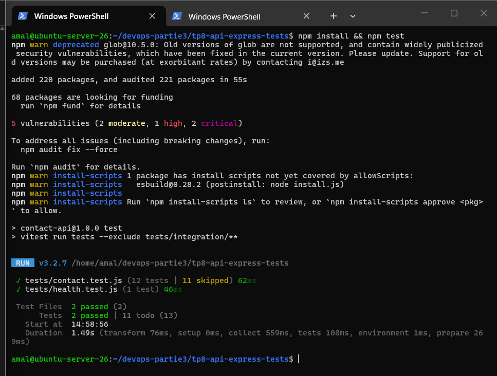

> `npm install` signale **5 vulnérabilités** (2 moderate, 1 high, 2 critical) dans les dépendances du starter. Elles n'ont pas été corrigées avec `npm audit fix --force` (risque de changements cassants) : ce point relève de l'audit de la chaîne d'approvisionnement traité au TP10.

### Architecture de la chaîne de middlewares

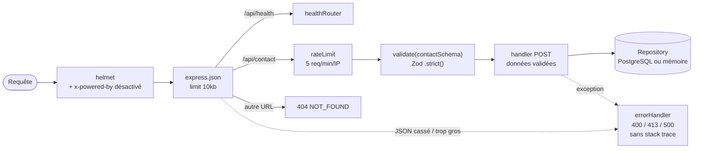

---

## 2. Partie 1 – OWASP API Security Top 10

### Trois attaques que la version initiale laissait passer

L'API d'origine a été démarrée contre PostgreSQL (`docker compose up -d --wait`, `npm run migrate`, `npm start`) puis attaquée avec `curl`.

**Attaque 1 – Divulgation de la stack trace (API8).** Un JSON tronqué provoque une réponse **500** contenant la stack complète : chemins internes du serveur (`/home/amal/...`), modules `body-parser` / `raw-body`, version de Node.

```bash
curl -s -X POST http://localhost:4000/api/contact -H 'Content-Type: application/json' -d '{"name": "Ada",'
```

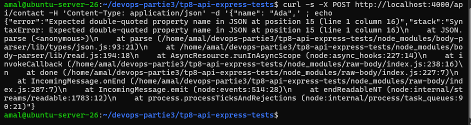

**Attaque 2 – Aucune validation et mass assignment (API3).** Un nom d'une lettre, un email invalide, un message trop court et un champ inconnu `isAdmin` sont **acceptés et enregistrés en base** (201).

```bash
curl -s -X POST http://localhost:4000/api/contact -H 'Content-Type: application/json' \
  -d '{"name":"x","email":"pas-un-email","message":"court","isAdmin":true}'
# {"id":1,"status":"received"}
```

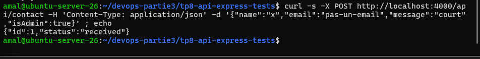

**Attaque 3 – En-têtes trop bavards et aucune limite de débit (API8 / API4 / API6).** `X-Powered-By: Express` révèle la technologie, aucun en-tête de sécurité n'est envoyé, et 10 requêtes successives sont toutes acceptées : rien n'empêche le spam du formulaire.

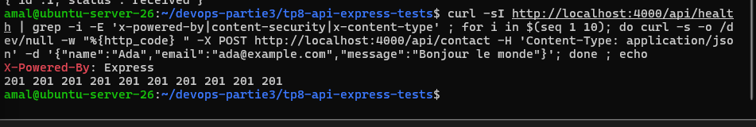

### Tableau des risques pour cette API

| Risque OWASP (2023) | Concerne notre API ? | Mesure dans ce TP |
|---|---|---|
| **API1** Broken Object Level Authorization | Non pour le `POST` : aucune route ne lit un objet par son id | La liste du défi 2 devrait être réservée à un administrateur en production |
| **API2** Broken Authentication | Non : formulaire public, sans authentification | Hors périmètre (TP16, Keycloak) |
| **API3** Broken Object Property Level Authorization | **Oui** : champs en trop acceptés (`isAdmin`) | Schéma Zod `.strict()` → 400 ; la liste du défi 2 ne renvoie pas l'email |
| **API4** Unrestricted Resource Consumption | **Oui** : pas de limite de taille ni de débit | `express.json({ limit: "10kb" })` → 413 ; rate limit 5 req/min/IP → 429 ; pagination ≤ 50 |
| **API5** Broken Function Level Authorization | Partiel : pas de fonction d'administration aujourd'hui | Une route de lecture ou de suppression devrait être protégée |
| **API6** Unrestricted Access to Sensitive Business Flows | **Oui** : le formulaire peut servir au spam | Rate limiting sur `/api/contact` (un CAPTCHA serait l'étape suivante) |
| **API7** Server Side Request Forgery | Non : l'API n'appelle aucune URL fournie par l'utilisateur | – |
| **API8** Security Misconfiguration | **Oui** : stack trace, `X-Powered-By`, pas d'en-têtes de sécurité, 404 HTML | Middleware d'erreur centralisé, `app.disable("x-powered-by")`, Helmet, 404 JSON |
| **API9** Improper Inventory Management | Partiel : petite API, routes à documenter | Routes listées dans ce README, route `/api/health` |
| **API10** Unsafe Consumption of APIs | Partiel : dépendances npm et base de données | Requêtes SQL **paramétrées**, validation de toutes les entrées, audit des dépendances (TP10) |

---

## 3. Partie 2 – Validation et gestion des erreurs

### Schéma Zod (`src/schemas/contact.js`)

```js
export const contactSchema = z
  .object({
    name: z.string().trim().min(2).max(100),
    email: z.string().trim().email().max(254),
    message: z.string().trim().min(10).max(2000),
  })
  .strict(); // tout champ inconnu (ex. isAdmin) est refusé : protection API3
```

### Middleware de validation (`src/middlewares/validate.js`)

`schema.safeParse(req.body)` ; en cas d'échec, réponse **400** `VALIDATION_ERROR` avec un `details` par champ. Pour un champ en trop, Zod place le nom dans `issue.keys` et non dans `issue.path` : il est récupéré pour que `isAdmin` apparaisse bien dans `field`. En cas de succès, `req.body` est **remplacé par les données validées** et la route ne lit que `name`, `email` et `message`.

```bash
curl -s -X POST http://localhost:4000/api/contact -H 'Content-Type: application/json' \
  -d '{"name":"x","email":"pas-un-email","message":"court","isAdmin":true}'
```

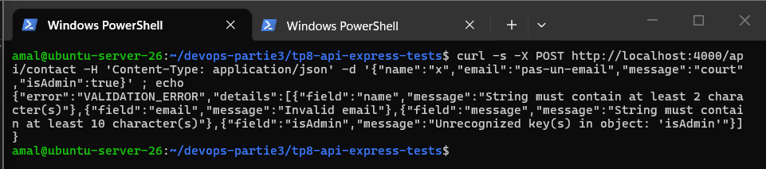

Les quatre problèmes sont signalés : `name` trop court, `email` invalide, `message` trop court et clé `isAdmin` non reconnue.

### Middleware d'erreur centralisé (`src/middlewares/errorHandler.js`)

| Cas | Code | Corps |
|---|---|---|
| JSON mal formé (`entity.parse.failed`) | 400 | `{ "error": "INVALID_JSON" }` |
| Corps trop gros (`entity.too.large`) | 413 | `{ "error": "PAYLOAD_TOO_LARGE" }` |
| Toute autre erreur | 500 | `{ "error": "INTERNAL_ERROR" }`, détail journalisé côté serveur uniquement |
| URL inconnue (middleware avant l'errorHandler) | 404 | `{ "error": "NOT_FOUND" }` |

La stack trace et les messages SQL ne sont **jamais** renvoyés au client.

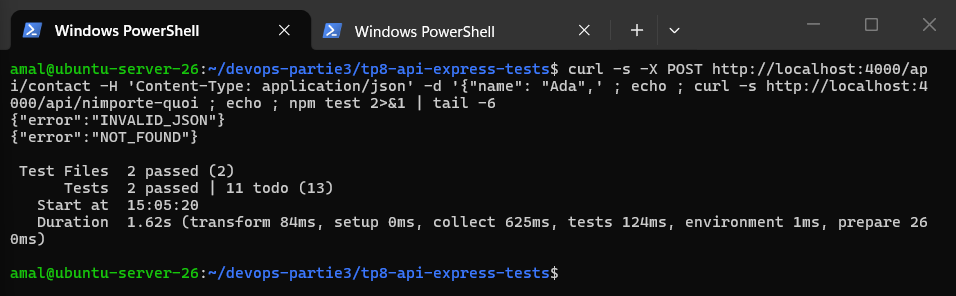

---

## 4. Partie 3 – Durcissement HTTP

### Helmet et `x-powered-by`

```js
app.disable("x-powered-by");
app.use(helmet());
```

Avant :

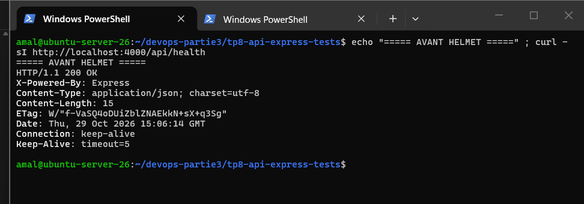

Après :

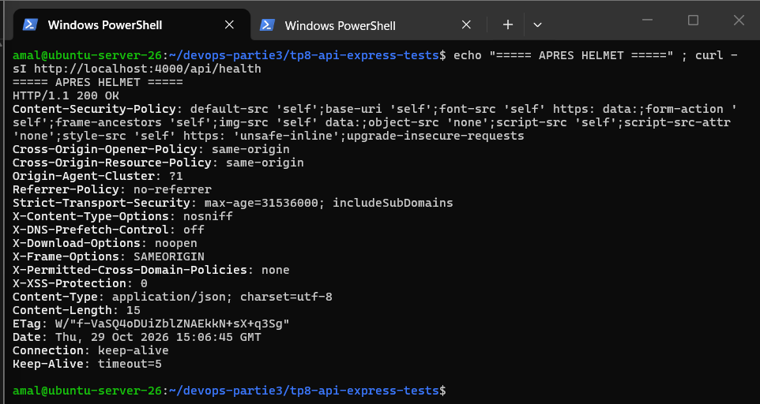

`X-Powered-By` a disparu ; Helmet ajoute notamment `Content-Security-Policy`, `Strict-Transport-Security`, `X-Content-Type-Options: nosniff`, `X-Frame-Options: SAMEORIGIN`, `Referrer-Policy` et les en-têtes `Cross-Origin-*`.

### Taille maximale du corps

`express.json({ limit: "10kb" })` : un corps de 20 059 octets est refusé avec **413 `PAYLOAD_TOO_LARGE`**, avant même d'être analysé.

### Rate limiting sur `/api/contact` uniquement

```js
const contactLimiter = rateLimit({
  windowMs: 60 * 1000,
  limit: 5,
  standardHeaders: "draft-7", // en-têtes RateLimit-* standard
  legacyHeaders: false,
  message: { error: "TOO_MANY_REQUESTS" },
});
app.use("/api/contact", contactLimiter, contactRouter({ contactRepository }));
```

```bash
for i in $(seq 1 7); do curl -s -o /dev/null -w "%{http_code}\n" -X POST http://localhost:4000/api/contact \
  -H 'Content-Type: application/json' -d '{"name":"Ada","email":"ada@example.com","message":"Bonjour le monde"}'; done
```

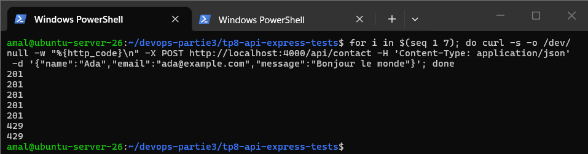

Cinq requêtes acceptées (201), puis **429**. `/api/health` n'est pas limité.

> Le limiteur est créé **dans** `createApp()` : chaque application de test démarre avec un compteur vierge. Derrière un reverse proxy (Nginx, Ingress), il faudrait ajouter `app.set("trust proxy", 1)`, sinon toutes les requêtes sembleraient venir de l'IP du proxy.

---

## 5. Partie 4 – Tests de routes et cas négatifs

Les tests utilisent **Supertest** (requêtes HTTP sans ouvrir de port) et le **repository en mémoire** injecté dans `createApp()` : ils sont rapides et ne dépendent d'aucune base.

| Test (`tests/contact.test.js`) | Vérifie |
|---|---|
| accepte un message valide | 201, `status: "received"`, 1 élément stocké |
| refuse un email invalide | 400 `VALIDATION_ERROR`, champ `email`, rien stocké |
| refuse un champ manquant | 400, champ `message` |
| refuse un champ supplémentaire (`isAdmin`) | 400, champ `isAdmin` |
| refuse un type inattendu (`message: 42`, `name: ['a']`) | 400, champs `name` et `message` |
| refuse un JSON mal formé | 400 `{ error: "INVALID_JSON" }`, pas de `stack` |
| refuse un corps de plus de 10 ko | 413 `PAYLOAD_TOO_LARGE` |
| stocke tel quel un nom avec injection SQL | 201, valeur identique à l'entrée |
| ne renvoie jamais de stack trace en 500 | repository qui lève une erreur → `{ error: "INTERNAL_ERROR" }`, ni `stack` ni message d'origine, erreur journalisée |
| ajoute les en-têtes Helmet | `x-content-type-options`, CSP, `x-frame-options`, HSTS |
| ne renvoie pas `x-powered-by` | en-tête absent |
| répond 429 après trop de requêtes | 5 × 201 puis 429, en-tête `ratelimit-policy` |
| *(bonus)* ne limite pas `/api/health` | 8 × 200 |
| *(bonus)* 404 JSON | `{ error: "NOT_FOUND" }` |

```bash
npm test
```

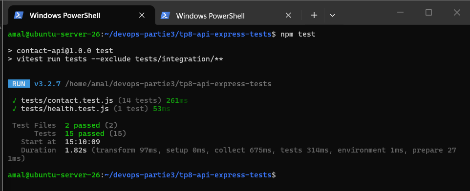

**15 tests passent, plus aucun `todo`** (avant le défi 2).

### Couverture

```bash
npm run test:coverage
```

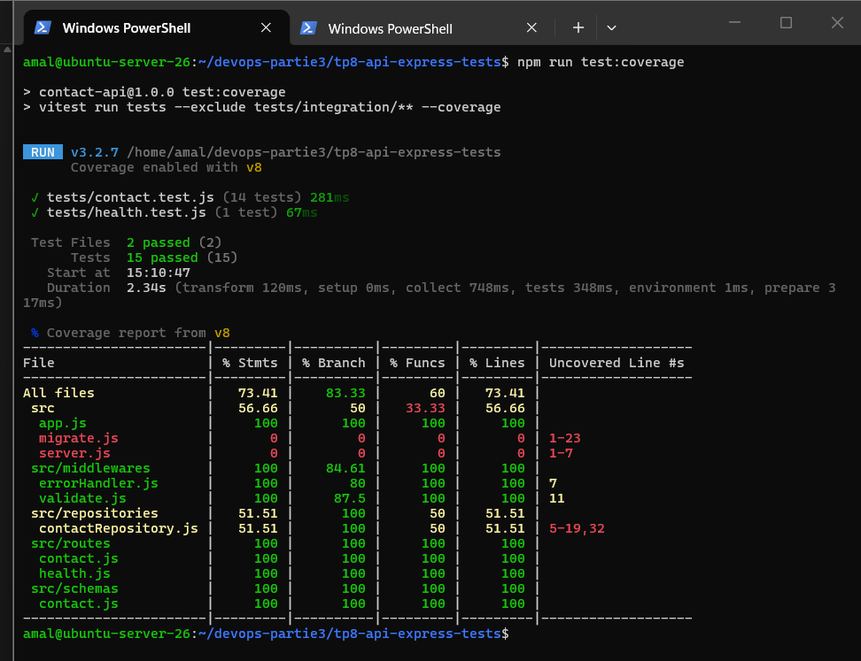

| Fichier | Couverture | Explication |
|---|---|---|
| `app.js`, `routes/*`, `schemas/contact.js` | 100 % | tout le code applicatif est testé |
| `middlewares/*` | 100 % des lignes, 80–87 % des branches | seules les branches défensives ne sont pas atteintes (`res.headersSent`, champ sans nom) |
| `contactRepository.js` | 51 % | seul le repository en mémoire sert aux tests de routes ; la partie PostgreSQL est couverte par les tests d'intégration |
| `server.js`, `migrate.js` | 0 % | scripts de démarrage, non exécutés par les tests de routes |

Le total (73 %) sous-estime donc la couverture réelle : la logique métier et de sécurité est couverte à 100 %.

---

## 6. Partie 5 – Intégration PostgreSQL et migrations

### Migrations idempotentes

`src/migrate.js` applique dans l'ordre les fichiers de `migrations/` et enregistre chaque fichier appliqué dans la table `schema_migrations` : une seconde exécution ne fait rien.

```bash
cp .env.example .env            # puis changement du mot de passe
set -a; . ./.env; set +a
docker compose up -d --wait
npm run migrate                 # migration appliquée : 001_create_contacts.sql
npm run migrate                 # rien à faire
```

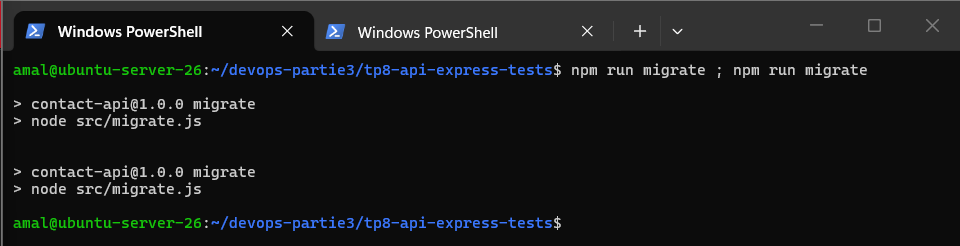

### Migration 002 : index sur `email`

```sql
-- migrations/002_add_contacts_email_index.sql
CREATE INDEX IF NOT EXISTS idx_contacts_email ON contacts (email);
```

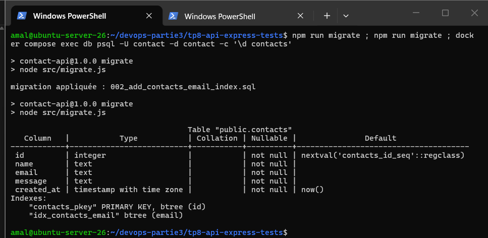

`\d contacts` montre l'index `idx_contacts_email` (btree) à côté de la clé primaire.

### Test d'intégration (`tests/integration/contact.int.test.js`)

| Test | Vérifie |
|---|---|
| enregistre un contact dans PostgreSQL | POST via Supertest puis **requête SQL directe** : la ligne est en base avec les bonnes valeurs et un `created_at` |
| résiste à une tentative d'injection SQL | `Robert'); DROP TABLE contacts;--` → 201, la table existe toujours (`to_regclass`), la valeur est stockée telle quelle |
| *(bonus)* n'écrit rien quand la requête est invalide | 400 et `count()` inchangé |

Les lignes créées par ces tests sont supprimées dans `afterAll`.

```bash
npm run test:integration
```

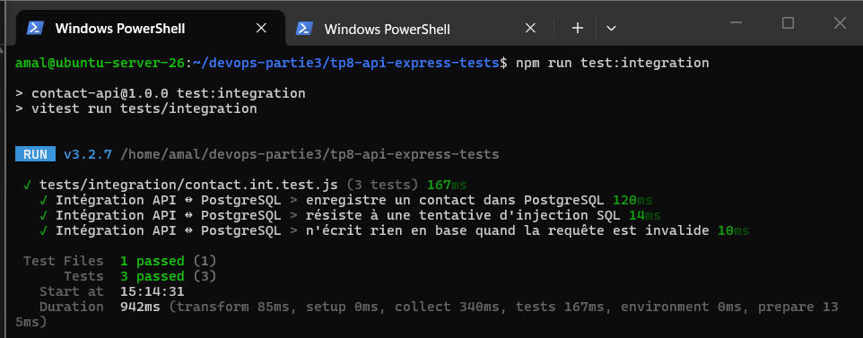

### Test manuel final

```bash
# requête valide, requête invalide, injection, puis contenu de la table
```

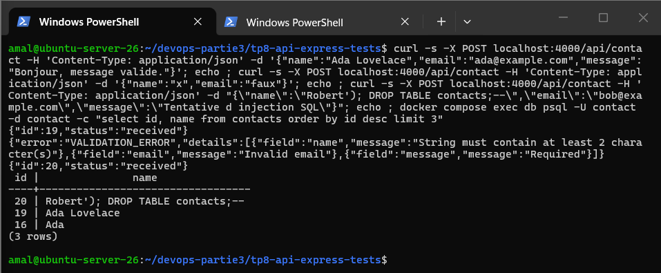

La requête valide et l'injection répondent 201, la requête invalide 400. La table `contacts` existe toujours et contient le nom piégé comme une simple chaîne : les **requêtes paramétrées** (`$1, $2, $3`) du repository empêchent toute interprétation SQL. Les ids 17 et 18, absents de la table, correspondent aux lignes créées puis supprimées par le test d'intégration.

---

## 7. Défi 1 – CI GitHub Actions

Fichier : [`.github/workflows/tp8-ci.yml`](../.github/workflows/tp8-ci.yml) (à la racine du dépôt).

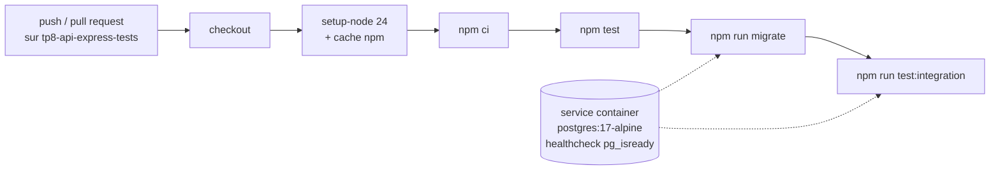

- le job démarre un **service container `postgres:17-alpine`** et attend qu'il soit sain (`pg_isready`) ;
- les variables `PG*` pointent vers ce conteneur éphémère, détruit à la fin du job (son mot de passe ne protège qu'une base jetable) ;
- le workflow ne se déclenche que si `tp8-api-express-tests/` ou le workflow lui-même change.

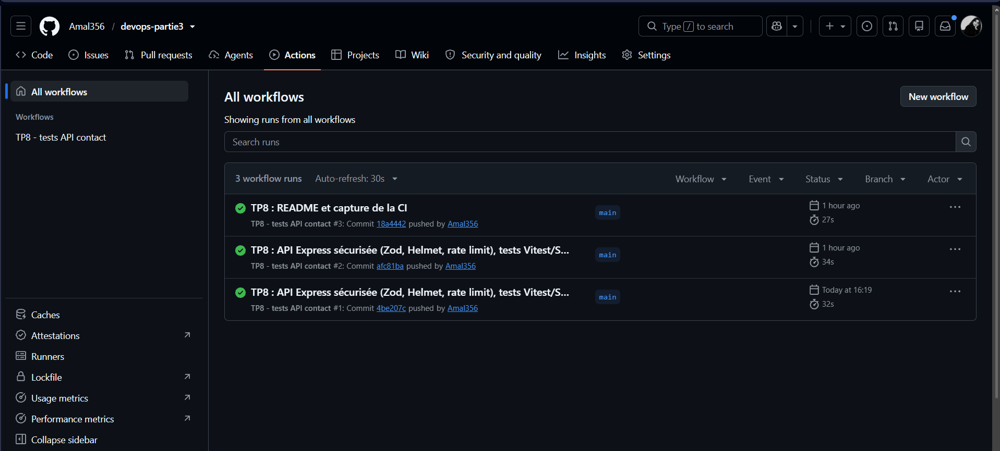

---

## 8. Défi 2 – Liste paginée `GET /api/contact`

```js
export const listQuerySchema = z
  .object({
    page: z.coerce.number().int().min(1).default(1),
    limit: z.coerce.number().int().min(1).max(50).default(10), // API4
  })
  .strict();
```

- `z.coerce.number()` convertit les paramètres d'URL (toujours des chaînes) en nombres ;
- `limit` est plafonné à **50** (API4) ; `page=abc`, `page=0`, `page=1.5`, `limit=-3`, `limit=51` et tout paramètre inconnu donnent **400** ;
- avec Express 5, `req.query` est en lecture seule : un middleware `validateQuery()` place les valeurs validées dans `res.locals.query` ;
- la réponse `{ page, limit, total, items }` **n'expose pas l'email** des contacts (API3) ;
- en production, cette route devrait être réservée à un administrateur authentifié (API1 / API5).

```bash
curl -s "localhost:4000/api/contact?page=1&limit=3"
curl -s "localhost:4000/api/contact?limit=51"
```

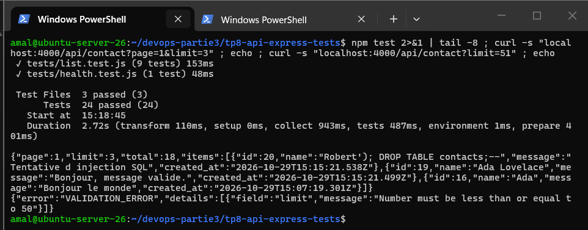

Les 9 tests de `tests/list.test.js` portent le total à **24 tests**.

---

## 9. Fichiers du rendu

```
tp8-api-express-tests/
├── README.md
├── .env.example              # variables attendues, sans vraie valeur (.env non versionné)
├── compose.yaml              # PostgreSQL 17 pour le développement et l'intégration
├── package.json / package-lock.json
├── migrations/
│   ├── 001_create_contacts.sql
│   └── 002_add_contacts_email_index.sql
├── src/
│   ├── app.js                # Helmet, limite 10 ko, rate limit, 404, errorHandler
│   ├── server.js / migrate.js
│   ├── middlewares/validate.js, errorHandler.js
│   ├── repositories/contactRepository.js
│   ├── routes/contact.js, health.js
│   └── schemas/contact.js
├── tests/
│   ├── contact.test.js       # 14 tests de routes
│   ├── list.test.js          # 9 tests de pagination (défi 2)
│   ├── health.test.js
│   └── integration/contact.int.test.js   # 3 tests contre PostgreSQL
└── captures/
.github/workflows/tp8-ci.yml  # défi 1 (à la racine du dépôt)
```

---

## 10. Difficultés et remarques

| Sujet | Constat | Solution |
|---|---|---|
| Collage de longs fichiers dans le terminal | Un long « heredoc » collé dans PowerShell via SSH a été tronqué | Fichiers longs (tests, défis) transférés avec `scp` |
| Champ en trop non nommé dans l'erreur | Avec `.strict()`, Zod met le nom de la clé dans `issue.keys`, pas dans `issue.path` | `field` construit à partir de `issue.keys` quand `path` est vide |
| `req.query` en Express 5 | Propriété en lecture seule : impossible d'y écrire les valeurs converties | Valeurs validées placées dans `res.locals.query` |
| Rate limit dans les tests | Un compteur partagé ferait échouer les tests suivants | Limiteur créé dans `createApp()`, une instance par test |
| Vulnérabilités npm du starter | `npm audit` : 5 vulnérabilités | Constat documenté, traitement prévu au TP10 (DevSecOps) |

## Sécurité

- Aucun secret dans le dépôt : `.env` est ignoré par Git, seul `.env.example` est versionné.
- Aucune information interne (stack trace, message SQL) n'est renvoyée au client.
- Toutes les requêtes SQL sont paramétrées.
